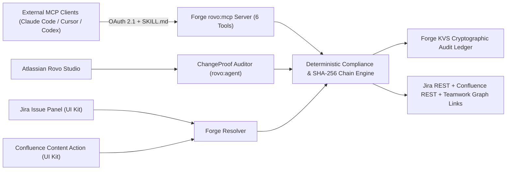

# ChangeProof MCP

**ChangeProof MCP** is an Atlassian Forge governance application for regulated industries (**FDA 21 CFR Part 11**, **ISO 13485**, and **AS9100D**) that combines a **Jira Issue Panel**, **Confluence SOP Impact Monitor**, native **Rovo Auditor Agent**, and a **`rovo:mcp` Model Context Protocol Server** with a bundled open-source Agent Skill.

It enforces cryptographic **separation-of-duties**, computes deterministic **FMEA Risk Priority Numbers (RPN)**, traces **Confluence SOP blast radius** across Jira and Teamwork Graph links, maintains a **SHA-256 tamper-evident audit chain** in Forge KVS storage, and compiles inspector-ready audit packets — with **$0 external LLM API cost** (powered natively by Atlassian Rovo and external MCP clients).

---

## Architecture



---

## 6 Exposed `rovo:mcp` & `rovo:agent` Tools

| Tool Key | Verb | Purpose |
|---|---|---|
| `assess-change-control` | `GET` | Scores Jira change-control/CAPA readiness (0–100) against `FDA_21CFR11`, `ISO_13485`, or `AS9100D` gates and FMEA RPN |
| `scan-sop-blast-radius` | `GET` | Traces controlled Confluence SOPs (`SOP-*`, `WI-*`, `QMS-*`) and Teamwork Graph links, flagging stale review cycles |
| `verify-dual-signoff` | `CREATE` | Strictly blocks proposer self-approval (`PROPOSER != QA_APPROVER != RELEASE_AUTHORITY`) and hashes attestations into Forge KVS |
| `verify-audit-chain` | `GET` | Recomputes every SHA-256 `payloadHash` & `entryHash` from Genesis (`0x00...00`) to detect 1-byte tampering or reordering |
| `generate-audit-packet` | `GET` | Compiles a signed Markdown + JSON FDA/ISO inspection dossier with `packetDigest` and chain `headHash` |
| `log-capa-deviation` | `CREATE` | Records a linked CAPA/deviation, appends it to the SHA-256 ledger, and posts a traceable Jira audit comment |

Companion open-source skill for external coding agents: [`skills/changeproof-mcp/SKILL.md`](./skills/changeproof-mcp/SKILL.md).

---

## Local Verification (Zero Credentials Required)

```bash
npm install
npm run verify
```

`npm run verify` runs:
1. `scripts/validate-manifest.js` — validates `manifest.yml` directly against the official `@forge/manifest` v16 JSON Schema via AJV and cross-checks every `rovo:mcp` tool, `rovo:agent` action, `function` handler export, and UI Kit resource path.
2. `node --test tests/*.test.js` — executes full unit and end-to-end integration tests across all 3 regulatory frameworks, separation-of-duties rejection, SHA-256 tamper detection, SOP blast-radius tracing, and all 6 MCP handlers.

---

## Deploying to Atlassian Cloud (Free 90-Day Codegeist Rovo Enterprise Site)

```bash
npx @forge/cli login
npx @forge/cli register
npx @forge/cli site provision
npx @forge/cli deploy
npx @forge/cli install --demo-site
```

### Judge Step-by-Step Walkthrough

1. Open any Jira Change Request issue on the demo site and expand **ChangeProof Compliance** in the issue panel.
2. Select a regulatory profile (`FDA 21 CFR Part 11`, `ISO 13485`, or `AS9100D`) to see live RPN calculation, gate blockers, and impacted Confluence SOPs.
3. Attempt to sign off as `QA_APPROVER` using the same account that reported the issue — observe the strict separation-of-duties rejection.
4. Sign off with an independent QA account (and Release Authority for high RPN) to append SHA-256 hash-chained attestations and inspect the **Verified** chain badge.
5. Click **Compile Inspector Dossier** or ask **ChangeProof Auditor** in Rovo Studio (or connect Claude Code / Cursor using `skills/changeproof-mcp/SKILL.md`) to run `assess-change-control` and `generate-audit-packet`.
